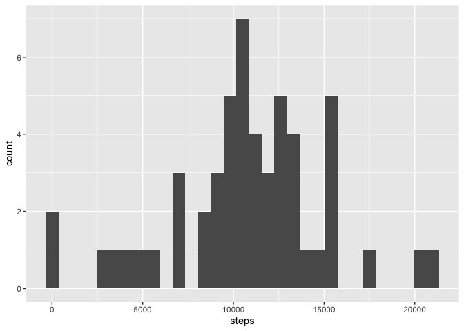
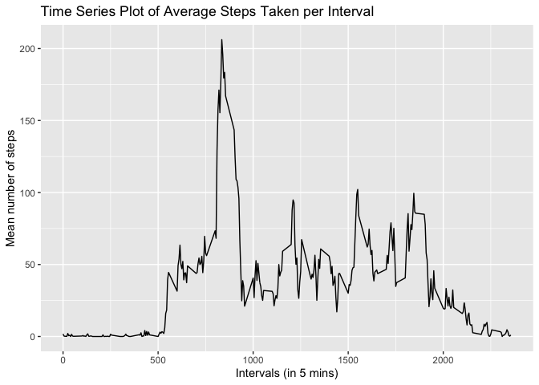
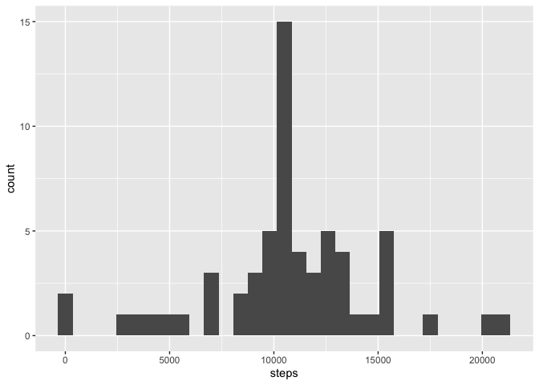
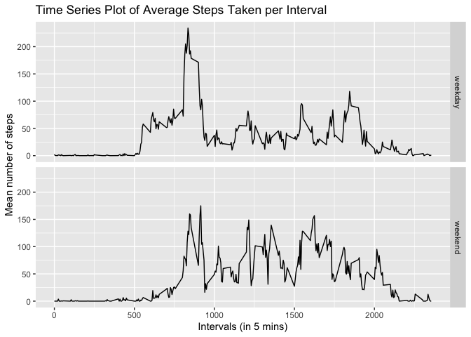

## Introduction

It is now possible to collect a large amount of data about personal movement using activity monitoring devices such as a Fitbit, Nike Fuelband, or Jawbone Up. These type of devices are part of the "quantified self" movement - a group of enthusiasts who take measurements about themselves regularly to improve their health, to find patterns in their behavior, or because they are tech geeks. But these data remain under-utilized both because the raw data are hard to obtain and there is a lack of statistical methods and software for processing and interpreting the data.

This assignment makes use of data from a personal activity monitoring device. This device collects data at 5 minute intervals through out the day. The data consists of two months of data from an anonymous individual collected during the months of October and November, 2012 and include the number of steps taken in 5 minute intervals each day.


## Data

he data for this assignment can be downloaded from the course web site:

* Dataset: Activity monitoring data [52K] (https://d396qusza40orc.cloudfront.net/repdata%2Fdata%2Factivity.zip)

The variables included in this dataset are:

* steps: Number of steps taking in a 5-minute interval (missing values are coded as NA)

* date: The date on which the measurement was taken in YYYY-MM-DD format

* interval: Identifier for the 5-minute interval in which measurement was taken

The dataset is stored in a comma-separated-value (CSV) file and there are a total of 17,568 observations in this dataset.


## Assignment

Set to show R code.


``` r
library(data.table)
library(ggplot2)
library(knitr)
opts_chunk$set(echo=TRUE)
```

### Loading and preprocessing the data


``` r
# Windows
#setwd("C:/Users/mchang/Projects/RepData_PeerAssessment1")

# Mac
setwd("/Users/mchang/Projects/RepData_PeerAssessment1")

path <- getwd()
datasetpath <- file.path(path,"dataset")
datafilename <- "dataFiles.zip"

# Download file
url <- "https://d396qusza40orc.cloudfront.net/repdata%2Fdata%2Factivity.zip"
#download.file(url, file.path(path, datafilename))
#unzip(zipfile = datafilename, exdir = datasetpath)

activity <- read.csv("activity.csv",sep=",",colClasses=c("numeric","Date","numeric"))
activity$date <- as.Date(activity$date,"%Y-%m-%d")
```

We can look at the data to confirm its content and dimensions.


``` r
head(activity)
```

```
##   steps       date interval
## 1    NA 2012-10-01        0
## 2    NA 2012-10-01        5
## 3    NA 2012-10-01       10
## 4    NA 2012-10-01       15
## 5    NA 2012-10-01       20
## 6    NA 2012-10-01       25
```

``` r
str(activity)
```

```
## 'data.frame':	17568 obs. of  3 variables:
##  $ steps   : num  NA NA NA NA NA NA NA NA NA NA ...
##  $ date    : Date, format: "2012-10-01" "2012-10-01" ...
##  $ interval: num  0 5 10 15 20 25 30 35 40 45 ...
```


### What is mean total number of steps taken per day?

- **Make a histogram of the total number of steps taken each day**

To get the total number of steps per day, we aggregate the steps data by date, taking care to remove all NA values. We can then plot a histogram using the ggplot2 function with a bin width of 700.


``` r
dailysteps <- aggregate(steps~date,activity, sum, na.rm=T)
head(dailysteps)
```

```
##         date steps
## 1 2012-10-02   126
## 2 2012-10-03 11352
## 3 2012-10-04 12116
## 4 2012-10-05 13294
## 5 2012-10-06 15420
## 6 2012-10-07 11015
```

``` r
ggplot(data=dailysteps,mapping=aes(x=steps)) + geom_histogram(binwidth=700)
```

<!-- -->

- **Calculate and report the mean and median of the total number of steps taken per day**


``` r
stepsmean <- format(mean(dailysteps$steps), scientific=FALSE)
stepsmedian <- format(median(dailysteps$steps), scientific=FALSE)
```

The required mean is 10766.19.  
The required median is 10765.

### What is the average daily activity pattern?

- **Make a time series plot of the 5-minute interval (x-axis) and the average number of steps taken, averaged across all days (y-axis)**

The same aggregate function is used to calculate the mean of the number of steps by interval. .


``` r
meanStepsByInterval <- aggregate(steps~interval,activity,mean)
head(meanStepsByInterval)
```

```
##   interval     steps
## 1        0 1.7169811
## 2        5 0.3396226
## 3       10 0.1320755
## 4       15 0.1509434
## 5       20 0.0754717
## 6       25 2.0943396
```

The results are plotted in a line graph using ggplot, with each interval on the x axis, and the average number of steps on the y axis.


``` r
ggplot(data=meanStepsByInterval,mapping=aes(x=interval,y=steps)) + geom_line() + labs(x="Intervals (in 5 mins)", y="Mean number of steps", title="Time Series Plot of Average Steps Taken per Interval")
```

<!-- -->

- **Which 5-minute interval, on average across all the days in the dataset, contains the maximum number of steps?**

``` r
stepsmax <- meanStepsByInterval[max(meanStepsByInterval$steps),]
```
The interval 1705 has the maximum average number of steps 56.3018868 recorded against it.

### Imputing missing values

- **Calculate and report the total number of missing values in the dataset**

Let's reconfirm that there are NAs in the original dataset


``` r
anyNA(activity)
```

```
## [1] TRUE
```

We should also confirm where the NAs are in the original dataset


``` r
sumNA <- colSums(is.na(activity))
sumNA
```

```
##    steps     date interval 
##     2304        0        0
```

We confirm that all NAs are contained within the steps column in the dataframe, and that there are 2304 NAs there.


- **Devise a strategy for filling in all of the missing values in the dataset. The strategy does not need to be sophisticated. For example, you could use the mean/median for that day, or the mean for that 5-minute interval, etc.**

We will fill in all the missing values with the mean for that 5 minute interval. The order of operations are:-

a. Create a new dataframe `activityfilled` that is equal to the original dataset


``` r
activityfilled <- activity
```

b. Use a for loop to iterate through the dataframe `activityfilled`. If the steps variable (1st column) is NA, fill it with the mean for the specified 5 minute interval calculated in the previous question and which exists in column 2 of `meanStepsByInterval`


``` r
for (x in 1:nrow(activityfilled))
{
  if (is.na(activityfilled[x,1])==TRUE)
  {
    activityfilled[x,1] <- meanStepsByInterval[meanStepsByInterval$interval %in% activityfilled[x,3],2]
  }
}
```
Take a look at the resulting dataframe `activityfilled`


``` r
head(activityfilled,20)
```

```
##        steps       date interval
## 1  1.7169811 2012-10-01        0
## 2  0.3396226 2012-10-01        5
## 3  0.1320755 2012-10-01       10
## 4  0.1509434 2012-10-01       15
## 5  0.0754717 2012-10-01       20
## 6  2.0943396 2012-10-01       25
## 7  0.5283019 2012-10-01       30
## 8  0.8679245 2012-10-01       35
## 9  0.0000000 2012-10-01       40
## 10 1.4716981 2012-10-01       45
## 11 0.3018868 2012-10-01       50
## 12 0.1320755 2012-10-01       55
## 13 0.3207547 2012-10-01      100
## 14 0.6792453 2012-10-01      105
## 15 0.1509434 2012-10-01      110
## 16 0.3396226 2012-10-01      115
## 17 0.0000000 2012-10-01      120
## 18 1.1132075 2012-10-01      125
## 19 1.8301887 2012-10-01      130
## 20 0.1698113 2012-10-01      135
```

d. We can find out the histogram, mean and median with the new dataframe.


``` r
dailysteps2 <- aggregate(steps~date,activityfilled, sum, na.rm=T)
head(dailysteps2)
```

```
##         date    steps
## 1 2012-10-01 10766.19
## 2 2012-10-02   126.00
## 3 2012-10-03 11352.00
## 4 2012-10-04 12116.00
## 5 2012-10-05 13294.00
## 6 2012-10-06 15420.00
```

``` r
steps2mean <- format(mean(dailysteps2$steps), scientific=FALSE)
steps2median <- format(median(dailysteps2$steps), scientific=FALSE)
ggplot(data=dailysteps2,mapping=aes(x=steps)) + geom_histogram(binwidth=700)
```

<!-- -->

The new mean is 10766.19 and the new median is 10766.19.

### Are there differences in activity patterns between weekdays and weekends?

- **Create a new factor variable in the dataset with two levels - "weekday" and "weekend" indicating whether a given date is a weekday or weekend day.**


``` r
activity$dayofweek <- weekdays(activity$date)
activity$daytype <- factor(ifelse(activity$dayofweek %in% c("Saturday","Sunday"),"weekend","weekday"))
head(activity)
```

```
##   steps       date interval dayofweek daytype
## 1    NA 2012-10-01        0    Monday weekday
## 2    NA 2012-10-01        5    Monday weekday
## 3    NA 2012-10-01       10    Monday weekday
## 4    NA 2012-10-01       15    Monday weekday
## 5    NA 2012-10-01       20    Monday weekday
## 6    NA 2012-10-01       25    Monday weekday
```

- **Make a panel plot containing a time series plot of the 5-minute interval (x-axis) and the average number of steps taken, averaged across all weekday days or weekend days (y-axis).**

``` r
meanSteps3ByInterval <- aggregate(steps~interval+daytype,activity,mean)
head(meanSteps3ByInterval)
```

```
##   interval daytype     steps
## 1        0 weekday 2.3333333
## 2        5 weekday 0.4615385
## 3       10 weekday 0.1794872
## 4       15 weekday 0.2051282
## 5       20 weekday 0.1025641
## 6       25 weekday 1.5128205
```

``` r
tail(meanSteps3ByInterval)
```

```
##     interval daytype     steps
## 571     2330 weekend  1.214286
## 572     2335 weekend 12.571429
## 573     2340 weekend  6.714286
## 574     2345 weekend  1.857143
## 575     2350 weekend  0.000000
## 576     2355 weekend  0.000000
```

``` r
ggplot(data=meanSteps3ByInterval,mapping=aes(x=interval,y=steps)) + geom_line() + facet_grid(rows = vars(daytype)) + labs(x="Intervals (in 5 mins)", y="Mean number of steps", title="Time Series Plot of Average Steps Taken per Interval")
```

<!-- -->

There is a noticeable less pronounced peak around the 0900 interval in the weekend plot, with its rise from the  0500 mark also less steep than the weekday plot.
